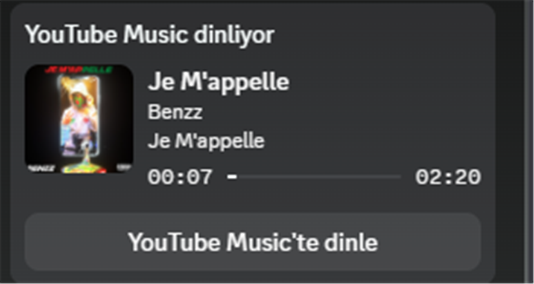
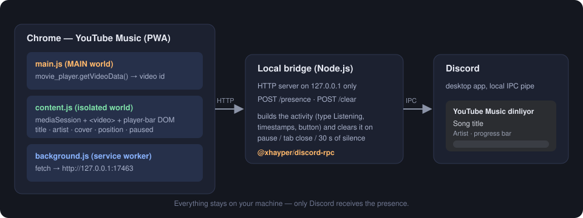

# YouTube Music → Discord Presence

🇹🇷 [Türkçe](README.md) · 🇬🇧 **English**

A small Chrome extension and local bridge that shows the song you're playing on YouTube Music in your Discord profile as
**"Listening to YouTube Music"**. The song title, artist, album cover, a progress bar and a **"YouTube Music'te dinle"**
button (Turkish for "Listen on YouTube Music") appear automatically. Anyone who visits your profile can click the button
to open the same song in their own YouTube Music app or at `music.youtube.com`.

<p align="center">
  
</p>

> The extension works with the [YouTube Music Chrome PWA](#installing-youtube-music-as-a-pwa) and with a regular Chrome tab.
> Data never leaves your computer except to Discord ([Privacy and security](#privacy-and-security)).

> The button label is Turkish because this project was written by a Turkish speaker. To change it, see
> [Customization](#customization).

---

## Table of contents

- [How it works](#how-it-works)
- [Technologies](#technologies)
- [Installation](#installation)
  - [1. Requirements](#1-requirements)
  - [2. Create a Discord application](#2-create-a-discord-application)
  - [3. Download the project and set up the bridge](#3-download-the-project-and-set-up-the-bridge)
  - [4. Load the extension in Chrome](#4-load-the-extension-in-chrome)
  - [5. Run it](#5-run-it)
  - [6. Start automatically with Windows (optional)](#6-start-automatically-with-windows-optional)
- [Installing YouTube Music as a PWA](#installing-youtube-music-as-a-pwa)
- [Troubleshooting](#troubleshooting)
- [Privacy and security](#privacy-and-security)
- [Project layout](#project-layout)
- [Customization](#customization)
- [Limitations](#limitations)
- [License](#license)

---

## How it works

Discord only accepts Rich Presence through a local channel (IPC) opened by its desktop app. A browser extension cannot
talk to that channel directly, so the work is split into three parts:

<p align="center">
  
</p>

1. **The extension reads the song.**
   - `main.js` runs in the page's own JavaScript world (`"world": "MAIN"`) and reads the video id from the player
     (`#movie_player`). It writes it to a `<html data-ytm-vid="…">` attribute. This extra step is needed because the
     extension's normal (isolated) script cannot see the page's JavaScript objects. In the PWA window the address bar
     may not contain `?v=`, so reading the id from the URL is not reliable.
   - `content.js` collects data once per second from `navigator.mediaSession` (title, artist, album, cover), the
     `<video>` element (duration, position, paused) and, as a fallback, the player bar's DOM.
   - It sends a message only when something changes: a new song, pause/resume, or a seek of more than ±3 seconds.
     While playing it sends a "still playing" heartbeat every 15 seconds.
2. **The service worker forwards the message to the bridge.** `background.js` sends `POST /presence` or `POST /clear`
   to `http://127.0.0.1:17463`.
3. **The bridge talks to Discord.** `bridge/index.js` is a small Node.js HTTP server. It turns the incoming data into a
   Discord activity and writes it to Discord's local channel with
   [`@xhayper/discord-rpc`](https://github.com/xhayper/discord-rpc):
   - `type: Listening` (the "Listening to …" text and progress bar),
   - song title → `details`, artist → `state`, cover → large image, album → image tooltip,
   - `startTimestamp` / `endTimestamp` for the progress bar,
   - a button linking to `https://music.youtube.com/watch?v=<id>`.

The bridge **clears the activity automatically** when the song is paused, the tab/window is closed, or no update has
arrived from the extension for 30 seconds. If Discord is closed the bridge waits quietly and reconnects when it opens.

---

## Technologies

| Part | Technology | Purpose |
| --- | --- | --- |
| Extension | Chrome Extension **Manifest V3** | Content scripts, service worker, `host_permissions` |
| Page access | `world: "MAIN"` content script | Reading the video id from the player API |
| Data source | Web Media Session API, HTMLMediaElement | Title, artist, cover, duration and position |
| Bridge | **Node.js** (ESM, a single dependency) | Local HTTP server and Discord connection |
| Discord | [`@xhayper/discord-rpc`](https://www.npmjs.com/package/@xhayper/discord-rpc) | Rich Presence (IPC) |
| Autostart | Windows Script Host (VBScript) + PowerShell | Run at login without a window |

There is no build step, bundler or framework. The extension is plain JavaScript.

---

## Installation

### 1. Requirements

- **Windows**: the bridge and autostart scripts were written for Windows. The bridge itself is plain Node.js, so it
  should also run on Linux/macOS, but this has not been tested.
- The **Discord desktop app** (not the browser version), running and signed in
- **Google Chrome** (other Chromium-based browsers may work, untested)
- **Node.js 22 or newer** ([download](https://nodejs.org)). Check with `node -v`

### 2. Create a Discord application

Discord needs an "application id" for Rich Presence. It is free and takes a minute.

1. Go to <https://discord.com/developers/applications> and click **New Application**.
2. Name it **YouTube Music**. The "Listening to **YouTube Music**" text on your profile comes from this name.
3. Copy the **Application ID** from the **General Information** page. It is not a secret.

### 3. Download the project and set up the bridge

```bash
git clone https://github.com/Rektama46OLAN/ytm-discord-rpc.git
cd ytm-discord-rpc/bridge
npm install
```

Create the config file and put your id in it:

```bash
copy config.example.json config.json
```

Open `bridge/config.json`:

```json
{
  "clientId": "YOUR_APPLICATION_ID"
}
```

> `config.json` is in `.gitignore` and never enters the repository. You can also provide the id through the
> `DISCORD_CLIENT_ID` environment variable.

### 4. Load the extension in Chrome

1. Open `chrome://extensions`.
2. Turn on **Developer mode** (top right).
3. Click **Load unpacked** and select the **`extension`** folder of this repository.

> Chrome remembers the folder path. Do not delete or move the folder after loading; if you do, remove the extension and
> load it again.

### 5. Run it

Start the bridge:

```bash
cd bridge
npm start
```

You should see these two lines:

```
Kopru 127.0.0.1:17463 uzerinde dinliyor.
Discord baglandi.
```

(They mean "Bridge listening on 127.0.0.1:17463" and "Discord connected".)

Then open YouTube Music (`music.youtube.com` or the PWA), refresh the page once (`F5`) and play a song. The card appears on
your Discord profile within a few seconds.

> **Note:** Discord shows buttons to **other people**, not on your own profile. To test the button, look at your profile
> from a second account or ask a friend.

### 6. Start automatically with Windows (optional)

If you don't want to start the bridge by hand every time, run it at login **without a window**:

```powershell
powershell -ExecutionPolicy Bypass -File .\install-autostart.ps1
```

This script adds a `YTM Discord Bridge.lnk` shortcut to your Startup folder. The shortcut runs `start-bridge.vbs`, which
starts `node bridge/index.js` in a hidden window. Paths are resolved from the script's own location, so the project can
live anywhere (if you move it, run the script again).

To remove it:

```powershell
powershell -ExecutionPolicy Bypass -File .\install-autostart.ps1 -Remove
```

To stop the running hidden bridge, end the matching `node.exe` process in Task Manager.

---

## Installing YouTube Music as a PWA

The "desktop app" version of YouTube Music is Chrome's PWA feature:

1. Open `music.youtube.com` in Chrome.
2. Click the **Install** icon at the right of the address bar (or `⋮` → **Cast, save and share → Install YouTube Music**).
3. A **YouTube Music** shortcut is created in the Start menu.

A PWA is Chrome itself, so extensions work there too. **The Chrome profile that has the extension must be the same
profile the PWA was installed in** (usually `Default`).

---

## Troubleshooting

| Symptom | Likely cause / fix |
| --- | --- |
| Bridge says "Discord Client ID missing" | `bridge/config.json` is missing or `clientId` is still the example text. Step 3. |
| Bridge is running but no card, and nothing appears in the terminal | The extension is not sending data. Reload the extension (↻) in `chrome://extensions` and press `F5` in the YouTube Music window. Make sure you use the same Chrome profile. |
| Page console shows `[ytm-discord] video kimligi bulunamadi` | No song is playing yet or the player has not loaded ("video id not found"). Start a song. |
| No `[ytm-discord]` lines in the console at all | The extension did not attach to that page. Reload the extension and refresh the page with `F5`. |
| Bridge logs requests but Discord shows nothing | Is the Discord desktop app running? In Settings → **Activity Privacy**, "Display current activity as a status message" must be on. Another activity (a game) may take priority. |
| No button | You can't see the button on your own profile. Check from a second account. |
| No cover image | Discord may reject some external image URLs. You can fall back to a fixed logo for `largeImageKey` in the bridge (see [Customization](#customization)). |
| `Extension context invalidated` after updating the extension | An open page keeps running the old version after the extension reloads. Refresh it with `F5`. |

To debug, press `Ctrl+Shift+I` in the YouTube Music window and look at lines starting with `[ytm-discord]` in the
**Console** tab. Each line explains what is happening.

---

## Privacy and security

- The bridge listens only on **`127.0.0.1`**. Other devices on your network cannot reach it.
- The extension's permissions cover only `https://music.youtube.com/*` and `http://127.0.0.1:17463/*`. It does not read
  your browsing history, cookies or other sites' data.
- Nothing is collected and nothing is sent to a third-party server. Song info leaves your computer only to **Discord**
  (like any Rich Presence). The cover image URL is also passed to Discord.
- The project uses Discord's official Rich Presence mechanism. It does not automate your user account (no "self-bot").
- Any local program that can send HTTP to the bridge can change your Discord status. This tool is not designed for shared
  machines where untrusted software runs.

---

## Project layout

```
ytm-discord-rpc/
├── extension/                 Chrome extension (Manifest V3)
│   ├── manifest.json
│   ├── main.js                page world: video id from the player
│   ├── content.js             reads song info, detects changes
│   └── background.js          forwards messages to the bridge over HTTP
├── bridge/                    Local bridge (Node.js)
│   ├── index.js               HTTP server + Discord Rich Presence
│   ├── config.example.json    config template (copy to config.json)
│   └── package.json
├── assets/                    README images
├── start-bridge.vbs           starts the bridge without a window
├── install-autostart.ps1      autostart at Windows login
└── LICENSE
```

---

## Customization

- **Card title:** the name of your Discord application (step 2). Changing it changes the "Listening to …" text.
- **Button text and URL:** the `buttons` field in `bridge/index.js`. The label can be at most 32 characters. The default
  label is Turkish ("YouTube Music'te dinle"); change it to e.g. `Listen on YouTube Music`.
- **Port:** `PORT` in `bridge/index.js` must change together with `17463` in `extension/background.js` and
  `manifest.json`.
- **Fixed cover:** replace `largeImageKey` in `applyPresence` with the name of an image you uploaded under **Rich Presence →
  Art Assets** in your Discord application.
- **Update frequency:** `HEARTBEAT_MS` and `SEEK_DRIFT_S` in `content.js`. Discord rate-limits very frequent updates.

---

## Limitations

- It only reads `music.youtube.com`. Regular YouTube (`youtube.com`) is not supported.
- The extension is loaded in developer mode and is not published on the Chrome Web Store. Chrome may occasionally show a
  "developer mode extensions" warning.
- If YouTube changes the page internals (the player bar, `movie_player`), the reading methods will need updating.
- Only one YouTube Music tab/window should be tracked at a time; several would fight over the presence.

---

## License

[MIT](LICENSE)

YouTube Music, YouTube and Google are trademarks of Google LLC. Discord is a trademark of Discord Inc. This project is
not affiliated with or endorsed by them.
