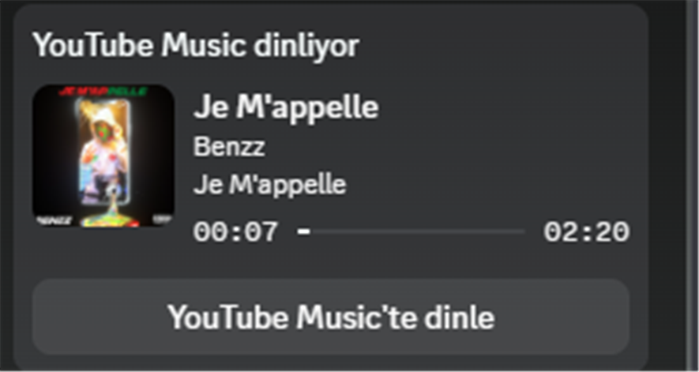
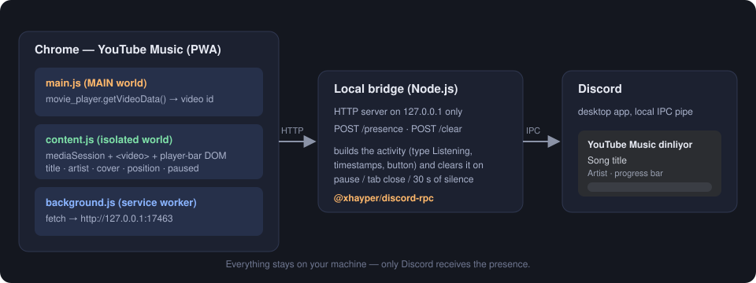

# YouTube Music → Discord Presence

YouTube Music'te çalan şarkıyı Discord profilinde **"YouTube Music dinliyor"** olarak gösteren küçük bir
Chrome eklentisi ve yerel köprü. Şarkı adı, sanatçı, albüm kapağı, ilerleme çubuğu ve profilini ziyaret
eden herkesin tıklayabileceği **"YouTube Music'te dinle"** butonu otomatik gelir. Buton, şarkıyı kendi YouTube
Music uygulamasında ya da `music.youtube.com` adresinde açar.

<p align="center">
  
</p>

> Eklenti [YouTube Music'in Chrome PWA'sı](#youtube-musici-pwa-olarak-kurmak) ile de, normal Chrome sekmesiyle de çalışır.
> Veri yalnızca kendi bilgisayarında dolaşır, hiçbir sunucuya gönderilmez ([Gizlilik](#gizlilik-ve-güvenlik)).

---

## İçindekiler

- [Nasıl çalışır?](#nasıl-çalışır)
- [Kullanılan teknolojiler](#kullanılan-teknolojiler)
- [Kurulum](#kurulum)
  - [1. Gereksinimler](#1-gereksinimler)
  - [2. Discord uygulaması oluştur](#2-discord-uygulaması-oluştur)
  - [3. Projeyi indir ve köprüyü kur](#3-projeyi-indir-ve-köprüyü-kur)
  - [4. Eklentiyi Chrome'a yükle](#4-eklentiyi-chromea-yükle)
  - [5. Çalıştır](#5-çalıştır)
  - [6. Windows açılışında otomatik başlat](#6-windows-açılışında-otomatik-başlat-isteğe-bağlı)
- [YouTube Music'i PWA olarak kurmak](#youtube-musici-pwa-olarak-kurmak)
- [Sorun giderme](#sorun-giderme)
- [Gizlilik ve güvenlik](#gizlilik-ve-güvenlik)
- [Proje yapısı](#proje-yapısı)
- [Özelleştirme](#özelleştirme)
- [Sınırlar](#sınırlar)
- [Lisans](#lisans)

---

## Nasıl çalışır?

Discord, kendi Rich Presence özelliğini yalnızca masaüstü uygulamasının yerel bir kanalı (IPC) üzerinden kabul eder.
Tarayıcıdaki bir eklenti o kanala doğrudan konuşamaz. Bu yüzden iş üç parçaya bölünmüştür:

<p align="center">
  
</p>

1. **Eklenti, şarkıyı okur.**
   - `main.js`, sayfanın kendi dünyasında (`"world": "MAIN"`) çalışır ve oynatıcıdan (`#movie_player`)
     video kimliğini alır. Bunu `<html data-ytm-vid="…">` özelliğine yazar. Eklentinin normal (izole) betiği
     sayfanın JavaScript nesnelerini göremediği için bu ara adım gereklidir. PWA penceresinde adres
     çubuğunda `?v=` bulunmayabilir, bu yüzden kimliği adresten okumak güvenilir değildir.
   - `content.js`, saniyede bir `navigator.mediaSession` (başlık, sanatçı, albüm, kapak), `<video>` öğesi
     (süre, konum, duraklatma) ve gerekirse oynatıcı çubuğunun DOM'undan bilgiyi toplar.
   - Sadece değişiklik olunca mesaj gönderir: yeni şarkı, duraklatma/devam, ±3 saniyeden fazla ileri-geri sarma.
     Çalarken 15 saniyede bir "hâlâ çalıyorum" sinyali yollar.
2. **Servis çalışanı mesajı köprüye taşır.** `background.js`, `http://127.0.0.1:17463` adresine
   `POST /presence` veya `POST /clear` yollar.
3. **Köprü, Discord'a konuşur.** `bridge/index.js` küçük bir Node.js HTTP sunucusudur. Gelen veriyi
   Discord etkinliğine çevirir ve [`@xhayper/discord-rpc`](https://github.com/xhayper/discord-rpc) ile Discord'un yerel kanalına yazar:
   - `type: Listening` ("… dinliyor" metni ve ilerleme çubuğu),
   - şarkı adı → `details`, sanatçı → `state`, kapak → büyük görsel, albüm → görsel üstü metin,
   - `startTimestamp` / `endTimestamp` ile süre çubuğu,
   - `https://music.youtube.com/watch?v=<kimlik>` adresine giden buton.

Köprü etkinliği şu durumlarda **otomatik temizler**: şarkı duraklatılınca, sekme/pencere kapanınca ya da eklentiden
30 saniye haber gelmezse. Discord kapalıysa köprü sessizce bekler, açılınca yeniden bağlanır.

---

## Kullanılan teknolojiler

| Parça | Teknoloji | Ne için? |
| --- | --- | --- |
| Eklenti | Chrome Extension **Manifest V3** | İçerik betikleri, servis çalışanı, `host_permissions` |
| Sayfa erişimi | `world: "MAIN"` içerik betiği | Oynatıcı API'sinden video kimliğini okumak |
| Veri kaynağı | Web Media Session API, HTMLMediaElement | Başlık, sanatçı, kapak, süre ve konum |
| Köprü | **Node.js** (ESM, bağımlılık: yalnızca bir paket) | Yerel HTTP sunucusu ve Discord bağlantısı |
| Discord | [`@xhayper/discord-rpc`](https://www.npmjs.com/package/@xhayper/discord-rpc) | Rich Presence (IPC) |
| Otomatik başlatma | Windows Script Host (VBScript) + PowerShell | Pencere açmadan açılışta çalıştırma |

Derleme adımı, paketleyici ya da çerçeve yoktur. Eklenti düz JavaScript'tir.

---

## Kurulum

### 1. Gereksinimler

- **Windows** (köprü ve otomatik başlatma betikleri Windows için yazıldı; köprünün kendisi Node.js olduğundan
  Linux/macOS'ta da çalışması beklenir, ancak denenmedi)
- **Discord masaüstü uygulaması** (tarayıcı sürümü değil) açık ve oturum açılmış olmalı
- **Google Chrome** (Chromium tabanlı diğer tarayıcılar da çalışabilir, denenmedi)
- **Node.js 22 veya üstü** ([indir](https://nodejs.org)). Kontrol: `node -v`

### 2. Discord uygulaması oluştur

Discord, Rich Presence için bir "uygulama kimliği" ister. Ücretsizdir ve bir dakika sürer.

1. <https://discord.com/developers/applications> adresine git, **New Application** de.
2. Adını **YouTube Music** yap. Profilde "**YouTube Music** dinliyor" yazısı bu addan gelir.
3. **General Information** sayfasındaki **Application ID** değerini kopyala. Bu gizli bir bilgi değildir.

### 3. Projeyi indir ve köprüyü kur

```bash
git clone https://github.com/Rektama46OLAN/ytm-discord-rpc.git
cd ytm-discord-rpc/bridge
npm install
```

Ayar dosyasını oluştur ve kimliğini içine yaz:

```bash
copy config.example.json config.json
```

`bridge/config.json` dosyasını aç:

```json
{
  "clientId": "BURAYA_APPLICATION_ID"
}
```

> `config.json` `.gitignore` içindedir, depoya girmez. İstersen kimliği `DISCORD_CLIENT_ID` ortam değişkeniyle de verebilirsin.

### 4. Eklentiyi Chrome'a yükle

1. Chrome'da `chrome://extensions` aç.
2. Sağ üstten **Geliştirici modu**nu aç.
3. **Paketlenmemiş öğe yükle** düğmesine bas ve bu depodaki **`extension`** klasörünü seç.

> Eklenti klasörünü yükledikten sonra silme ya da taşıma, Chrome yolu hatırlar. Taşırsan eklentiyi kaldırıp yeniden yükle.

### 5. Çalıştır

Köprüyü başlat:

```bash
cd bridge
npm start
```

Şu iki satırı görmelisin:

```
Kopru 127.0.0.1:17463 uzerinde dinliyor.
Discord baglandi.
```

Sonra YouTube Music'i aç (`music.youtube.com` ya da PWA), sayfayı bir kez yenile (`F5`) ve bir şarkı çal.
Birkaç saniye içinde Discord profilinde kart görünür.

> **Not:** Discord, butonları **başkalarına** gösterir, kendi profilinde göstermez. Butonu denemek için ikinci bir
> hesaptan ya da bir arkadaşının gözünden bakmalısın.

### 6. Windows açılışında otomatik başlat (isteğe bağlı)

Köprüyü her seferinde elle başlatmak istemiyorsan, açılışta **pencere açmadan** çalıştır:

```powershell
powershell -ExecutionPolicy Bypass -File .\install-autostart.ps1
```

Bu betik, Başlangıç klasörüne `YTM Discord Bridge.lnk` kısayolu ekler. Kısayol `start-bridge.vbs` dosyasını çalıştırır,
o da `node bridge/index.js` komutunu gizli bir pencerede başlatır. Klasörün yolu betiğin kendi konumundan çözülür, projeyi
istediğin yere koyabilirsin (taşırsan betiği yeniden çalıştır).

Kaldırmak için:

```powershell
powershell -ExecutionPolicy Bypass -File .\install-autostart.ps1 -Remove
```

Çalışan gizli köprüyü durdurmak için Görev Yöneticisi'nde ilgili `node.exe` sürecini sonlandır.

---

## YouTube Music'i PWA olarak kurmak

"Masaüstü uygulaması" gibi çalışan YouTube Music, aslında Chrome'un PWA özelliğidir:

1. Chrome'da `music.youtube.com` aç.
2. Adres çubuğunun sağındaki **Yükle** simgesine (ya da `⋮` → **Cast, kaydet ve paylaş → YouTube Music'i yükle**) tıkla.
3. Başlat menüsünde **YouTube Music** kısayolu oluşur.

PWA, Chrome'un kendisi olduğu için eklentiler orada da çalışır. **Eklentinin yüklü olduğu Chrome profili ile PWA'nın
kurulduğu profil aynı olmalıdır** (çoğu kişide `Default`).

---

## Sorun giderme

| Belirti | Olası neden / çözüm |
| --- | --- |
| Köprü "Discord Client ID missing" diyor | `bridge/config.json` yok ya da `clientId` hâlâ örnek metin. Adım 3. |
| Köprü açık ama profilde kart yok, terminale hiçbir satır düşmüyor | Eklenti veri göndermiyor. `chrome://extensions` içinde eklentiyi yenile (↻), YouTube Music penceresinde `F5` yap. Aynı Chrome profilini kullandığından emin ol. |
| Sayfa konsolunda `[ytm-discord] video kimligi bulunamadi` | Şarkı henüz çalmıyor ya da oynatıcı yüklenmedi. Bir şarkı başlat. |
| Konsolda hiç `[ytm-discord]` satırı yok | Eklenti o sayfaya girmemiş. Eklentiyi yeniden yükle, sayfayı `F5` ile yenile. |
| Köprüde satırlar akıyor ama Discord'da görünmüyor | Discord masaüstü uygulaması açık mı? Ayarlar → **Etkinlik Gizliliği** → "Mevcut etkinliği durum mesajı olarak göster" açık olmalı. Başka bir etkinlik (oyun) seçili olabilir. |
| Buton görünmüyor | Butonu kendi profilinde göremezsin. İkinci hesaptan kontrol et. |
| Kapak resmi yok | Discord bazı dış görsel adreslerini reddedebilir. Köprüde `largeImageKey` için sabit bir logoya düşebilirsin (bkz. [Özelleştirme](#özelleştirme)). |
| Eklenti güncellemeden sonra `Extension context invalidated` uyarısı | Eklenti yenilenince açık sayfa eski sürümle kalır. Sayfayı `F5` ile yenile. |

Hata ayıklamak için YouTube Music penceresinde `Ctrl+Shift+I` → **Console** sekmesinde `[ytm-discord]` ile başlayan
satırlara bak. Her satır ne olduğunu açıklar.

---

## Gizlilik ve güvenlik

- Köprü yalnızca **`127.0.0.1`** adresini dinler. Ağdaki başka cihazlar erişemez.
- Eklentinin izinleri yalnızca `https://music.youtube.com/*` sayfalarını ve `http://127.0.0.1:17463/*` adresini kapsar.
  Tarama geçmişini, çerezleri ya da başka sitelerin verilerini okumaz.
- Hiçbir veri toplanmaz ve üçüncü taraf bir sunucuya gönderilmez. Şarkı bilgisi bilgisayarından yalnızca **Discord'a**
  gider (normal Rich Presence gibi). Kapak resminin adresi de Discord'a iletilir.
- Proje, Discord'un resmi Rich Presence mekanizmasını kullanır. Kullanıcı hesabıyla otomasyon ya da "self-bot" yapmaz.
- Köprüye HTTP ile veri yollayan herhangi bir yerel program Discord durumunu değiştirebilir. Bu araç, güvenilmeyen
  yazılımların çalıştığı paylaşımlı makineler için tasarlanmadı.

---

## Proje yapısı

```
ytm-discord-rpc/
├── extension/                 Chrome eklentisi (Manifest V3)
│   ├── manifest.json
│   ├── main.js                sayfa dünyası: oynatıcıdan video kimliği
│   ├── content.js             şarkı bilgisi okuma, değişiklik algılama
│   └── background.js          mesajı köprüye HTTP ile iletir
├── bridge/                    Yerel köprü (Node.js)
│   ├── index.js               HTTP sunucusu + Discord Rich Presence
│   ├── config.example.json    ayar şablonu (config.json'a kopyala)
│   └── package.json
├── assets/                    README görselleri
├── start-bridge.vbs           köprüyü pencere açmadan başlatır
├── install-autostart.ps1      Windows açılışında otomatik başlatma
└── LICENSE
```

---

## Özelleştirme

- **Kart başlığı:** Discord uygulamanın adı (adım 2). Değiştirince profilde "… dinliyor" metni değişir.
- **Buton metni ve adresi:** `bridge/index.js` içinde `buttons` alanı. Metin en fazla 32 karakter olabilir.
- **Port:** `bridge/index.js` içindeki `PORT` ve `extension/background.js` ile `manifest.json` içindeki `17463` birlikte değişmeli.
- **Sabit kapak:** `applyPresence` içindeki `largeImageKey` değerini, Discord uygulamasının **Rich Presence → Art Assets**
  bölümüne yüklediğin bir görselin adıyla değiştir.
- **Güncelleme sıklığı:** `content.js` içindeki `HEARTBEAT_MS` ve `SEEK_DRIFT_S`. Discord, çok sık güncellemeyi sınırlar.

---

## Sınırlar

- Yalnızca `music.youtube.com` sayfalarını okur. Normal YouTube (`youtube.com`) desteklenmez.
- Eklenti geliştirici modunda yüklenir, Chrome Web Store'da yayınlanmış değildir. Chrome ara sıra "geliştirici modu
  eklentileri" uyarısı gösterebilir.
- Sayfanın iç yapısı YouTube tarafından değiştirilirse (oynatıcı çubuğu, `movie_player`), okuma yöntemleri güncellenmelidir.
- Aynı anda yalnızca bir YouTube Music sekmesi/penceresi izlenmelidir; birden fazlası presence'ı birbiriyle yarıştırır.

---

## Lisans

[MIT](LICENSE)

YouTube Music, YouTube ve Google; Google LLC'nin ticari markalarıdır. Discord, Discord Inc.'in markasıdır. Bu proje
bunlarla bağlantılı değildir ve onlar tarafından onaylanmamıştır.
